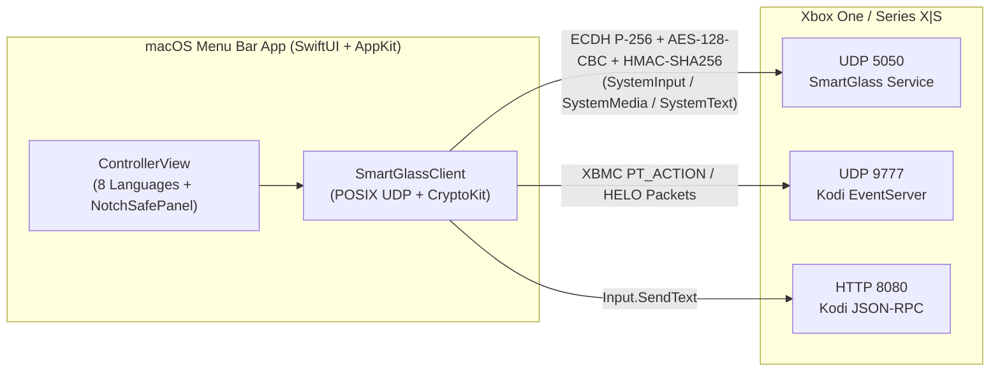

# 🎮 XboxMacOSController

<p align="center">
  <b>Native macOS Menu Bar (Toolbar) Xbox Remote Controller, Keyboard & IPTV Companion</b><br/>
  <i>Zero-dependency Swift implementation of the Xbox SmartGlass Protocol (UDP 5050) + Kodi EventServer (UDP 9777)</i>
</p>

<p align="center">
  
  
  
  
  
  
</p>

<p align="center">
  <a href="#-english-documentation">🇬🇧 English</a> •
  <a href="#-türkçe-dokümantasyon">🇹🇷 Türkçe</a>
</p>

---

## 🇬🇧 English Documentation

**XboxMacOSController** is a permanent, lightweight, native macOS Menu Bar (Toolbar) utility that lets you control your **Xbox One / Xbox Series X|S** directly from your Mac—without needing a physical gamepad, Xbox Live sign-in, or third-party dependencies.

### ✨ Key Features

- **🖥️ Notch & Dynamic Island Safe Menu Bar Panel (`NotchSafePanel`)**
  - Custom `NSPanel` architecture overriding AppKit's `constrainFrameRect(_:to:)` and utilizing `NSScreen.auxiliaryTopLeftArea` / `auxiliaryTopRightArea` & `safeAreaInsets.top`.
  - Guarantees the controller never overlaps or gets buried inside the MacBook Notch / Dynamic Island, with a fixed-width (`26pt`) status icon that prevents Menu Bar jitter.
- **🔐 Pure Native Xbox SmartGlass Protocol (`UDP 5050`)**
  - Zero external libraries: built entirely on Apple `CryptoKit`, `CommonCrypto`, `Security`, and POSIX non-blocking UDP sockets.
  - Full X.509 DER certificate parsing (`0xDD01`), **ECDH P-256** key agreement, **SHA-512 KDF**, **AES-128-CBC** packet encryption, and **HMAC-SHA256** packet authentication (`0xCC00` / `0xD00D`).
- **📺 Hybrid Xbox + Kodi + UWP IPTV Navigation Engine**
  - Simultaneously drives **Xbox SmartGlass** (`SystemInput`, `SystemMedia`, `SystemText`) and **Kodi EventServer (`UDP 9777` `PT_ACTION`)** + **Kodi JSON-RPC (`HTTP 8080`)**.
  - Includes a **Navigation Mode Switcher** (`D-Pad + Kodi`, `Analog + Kodi`, `Both`) that injects Left Thumbstick (`Float32BE` `±1.0`) pulses for UWP IPTV apps running in Xbox Mouse/Pointer mode.
- **⚡ 1-Click "Unfreeze IPTV Stream" Macro**
  - Instantly recovers stalled or frozen live IPTV streams using 3 selectable macro strategies (`CH- → CH+`, `Back → Select`, or `Stop → Play`).
- **⌨️ Instant Clipboard Paste & Send (`Cmd+V`)**
  - Type or paste long search queries, passwords, or M3U playlist URLs from your Mac straight into the Xbox On-Screen Keyboard (`SystemText` `0xF2C` / `0xF2D`) or Kodi input dialogs with a single click.
- **🔌 Power On (`0xDD02` Wake) & Power Off (`0x01F`)**
  - Wake your Xbox from standby or power it off directly from the macOS Menu Bar.
- **🌍 8 Built-in Languages (Instant Switcher)**
  - 🇬🇧 English • 🇹🇷 Türkçe • 🇩🇪 Deutsch • 🇪🇸 Español • 🇫🇷 Français • 🇵🇹 Português • 🇷🇺 Русский • 🇯🇵 日本語

---

### 🏗️ Architecture



---

### 🚀 Quick Start (Build & Run in 1 Command)

#### Requirements
- **macOS 13.0 (Ventura)** or later (Apple Silicon `arm64` & Intel `x86_64` supported)
- Xcode Command Line Tools (`xcode-select --install`)

#### Build & Launch `.app` Bundle
```bash
git clone https://github.com/kursadrrr/xboxmacoscontroller.git
cd xboxmacoscontroller
chmod +x build_and_run.sh
./build_and_run.sh
```
This compiles a native release binary (`XboxToolbarController.app`), signs it locally, and places the controller icon in your macOS Menu Bar.

---

### ⌨️ Mac Keyboard Shortcuts (When "Keys" is Enabled)

| Mac Key | Xbox Action |
| :--- | :--- |
| `▲` `▼` `◀` `▶` Arrow Keys | D-Pad / Left Thumbstick Navigation |
| `Enter` / `Space` | **A** (Select / OK) |
| `Esc` | **B** (Back) |
| `H` | **Xbox Guide / Home** (`Nexus`) |
| `M` | **Menu** (`☰`) |
| `V` | **View** (`⧉`) |
| `X` / `Y` | **X** / **Y** Buttons |
| `[` / `]` | **LB** / **RB** Shoulder Buttons |
| `R` | **Unfreeze IPTV Stream** Macro |

---

### ⚙️ Xbox Console Setup

1. On your Xbox, open **Settings → Devices & connections → Remote features**.
2. Enable **Enable remote features**.
3. Under **Xbox app preferences**, select **Allow connections from any device**.
4. *(Optional for Kodi)* In Kodi, enable **Settings → Services → Control → Allow remote control from applications on other systems**.

---
---

## 🇹🇷 Türkçe Dokümantasyon

**XboxMacOSController**, **Xbox One / Xbox Series X|S** konsolunuzu doğrudan Mac'inizin üst menü çubuğundan (Menu Bar / Toolbar) kontrol etmenizi sağlayan, sıfır bağımlılıklı, yerel (native) bir macOS uygulamasıdır.

### ✨ Öne Çıkan Özellikler

- **🖥️ Notch & Dynamic Island Korumalı Toolbar Paneli (`NotchSafePanel`)**
  - AppKit `constrainFrameRect(_:to:)`, `safeAreaInsets.top` ve `auxiliaryTopRightArea` API'lerini kullanan özel `NSPanel` mimarisi sayesinde pencere asla yukarı kaçmaz ve MacBook kamera çentiği / Dynamic Island içine gömülmez.
- **🔐 Sıfır Bağımlılıklı Native Xbox SmartGlass Protokolü (`UDP 5050`)**
  - Harici kütüphane kullanmadan tamamen Apple `CryptoKit`, `CommonCrypto` ve `Security` ile yazılmıştır.
  - X.509 sertifika ayrıştırma (`0xDD01`), **ECDH P-256** anahtar değişimi, **SHA-512 KDF**, **AES-128-CBC** şifreleme ve **HMAC-SHA256** paket doğrulama.
- **📺 Hibrit Xbox + Kodi + UWP IPTV Yönlendirme Motoru**
  - Hem **Xbox SmartGlass** (`SystemInput`, `SystemMedia`, `SystemText`) hem de **Kodi EventServer (`UDP 9777`)** + **Kodi JSON-RPC (`HTTP 8080`)** protokollerini aynı anda çalıştırır.
  - Fare/imleç modunda çalışan UWP IPTV uygulamaları için **Yön Modu Seçici** (`D-Pad + Kodi`, `Analog + Kodi`, `Tümü`) içerir.
- **⚡ Tek Tıkla "Donan IPTV'yi Canlandır" Makrosu**
  - Donan canlı IPTV yayınlarını tek tıkla yeniler (`CH- → CH+`, `Geri Çık → Tekrar Gir` veya `Durdur → Oynat` modları).
- **⌨️ Tek Tıkla Panodan Yapıştır & Gönder (`Cmd+V`)**
  - Mac panosundaki (`Cmd+C`) uzun metinleri veya M3U linklerini tek tıkla Xbox ekran klavyesine (`SystemText`) ve Kodi'ye gönderir.
- **🌍 8 Dil Desteği**
  - Uygulama üst barındaki `🌐` menüsünden **Türkçe, İngilizce, Almanca, İspanyolca, Fransızca, Portekizce, Rusça ve Japonca** arasında anında geçiş yapılabilir.

### 🚀 Kurulum ve Çalıştırma

```bash
git clone https://github.com/kursadrrr/xboxmacoscontroller.git
cd xboxmacoscontroller
chmod +x build_and_run.sh
./build_and_run.sh
```

---

## 📄 License

Released under the [MIT License](LICENSE).
